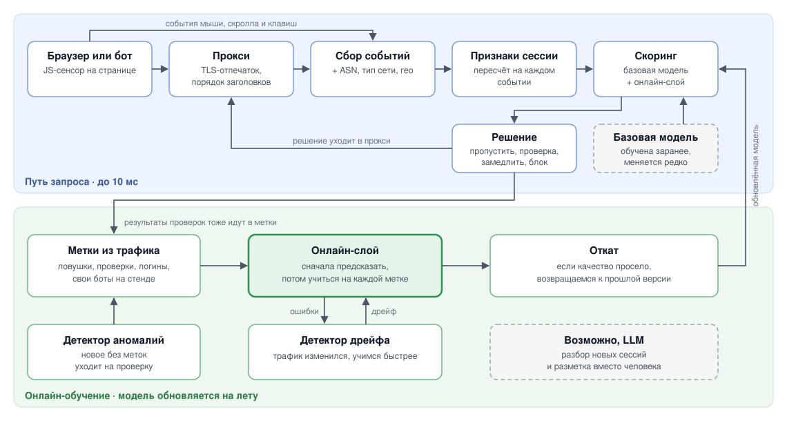

# ML System Design: детектор ботов в веб-трафике

[](https://github.com/vladmsnk/ml-system-design-course/actions/workflows/ci.yml)

ML-модуль, который смотрит на трафик сайта и по каждой сессии решает, человек это или бот. Учится онлайн, прямо на потоке запросов, и подстраивается, когда трафик меняется. Проект курса ML System Design.

**[Дизайн-документ](docs/ml_system_design_doc.md)**

## Зачем

Ботов в вебе уже больше, чем людей: в 2024 году они дали 51% трафика, а вредоносные боты составили 37% всего трафика ([Imperva Bad Bot Report 2025](https://www.thalesgroup.com/en/news-centre/press-releases/artificial-intelligence-fuels-rise-hard-detect-bots-now-make-more-half)). Они скачивают контент, перебирают пароли, накручивают метрики и грузят сервер.

Обычно от ботов защищаются правилами, которые пишут вручную: чёрные списки IP, лимиты запросов, капча. Такие правила устаревают за дни. Резидентные прокси дают боту тысячи домашних IP, распределённые боты не упираются в лимиты, капчу решают нейросети. А AI-агенты ходят через настоящий браузер с человеческими паузами, и простые правила их не видят.

## Как работает



- За основу берём базовую модель, обученную заранее на открытом датасете и на данных стенда (тестового сайта).
- Поверх неё работает онлайн-слой. Он дообучается на каждой новой метке, то есть когда становится известно, бот это был или человек. Поэтому он подстраивается под новых ботов и смену трафика за минуты и не ждёт ночного переобучения.
- Метки берутся из самого трафика: ловушки для ботов, результаты невидимых проверок, неудачные логины, наши собственные боты на стенде.
- Детектор дрейфа замечает, что трафик поменялся, и ускоряет обучение. Если качество просело, модель возвращается к прошлой версии.
- Решение зависит от уверенности модели: пропустить, показать проверку, замедлить или заблокировать. На логине пороги строже, чем на каталоге.

Решение предварительное и будет меняться по ходу курса. Возможно, добавим LLM для разбора новых сессий.

Подробнее в [дизайн-документе](docs/ml_system_design_doc.md).

## Структура

```
.
├── docs/
│   ├── ml_system_design_doc.md   # дизайн-документ
│   └── images/                   # схемы
├── src/bot_detector/             # код модуля
├── tests/
├── .github/workflows/ci.yml      # pre-commit и тесты на каждый PR
├── .pre-commit-config.yaml
├── pyproject.toml                # зависимости, настройки ruff, mypy, pytest
└── Makefile
```

## Быстрый старт

Нужен Python 3.11 или новее.

```bash
git clone https://github.com/vladmsnk/ml-system-design-course.git
cd ml-system-design-course
make install   # .venv, dev-зависимости и git-хуки pre-commit
make check     # то же самое, что запускает CI
```

С [uv](https://docs.astral.sh/uv/) так:

```bash
uv sync
uv run pre-commit install
```

## Качество кода

| Инструмент | Что делает | Команда |
|---|---|---|
| ruff | линтер и форматер | `make lint`, `make format` |
| mypy | проверка типов в strict-режиме | `make typecheck` |
| pre-commit | ruff, mypy, очистка ноутбуков, запрет файлов больше 1 MB и приватных ключей, запрет коммитов в `main` | запускается на `git commit` |
| GitHub Actions | всё то же самое на каждый PR и push в `main` | |

Данные и веса моделей в git не кладём, для них будут DVC и MLflow.

## Домашние задания

Каждая домашка идёт в своей ветке `hw_n`, потом PR в `main`, ревью ментора и двух студентов и merge.

| № | Что | Ветка | Статус |
|---|---|---|---|
| 1 | Сетап репозитория, дизайн-документ | `hw_1` | на ревью |

## Лицензия

[MIT](LICENSE)
