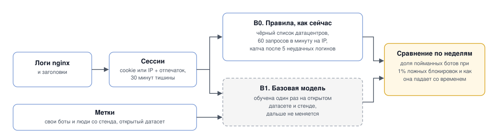

# ML System Design Doc: детектор ботов в веб-трафике

Bot Detector, MVP. Структура по [шаблону Reliable ML](https://github.com/IrinaGoloshchapova/ml_system_design_doc_ru/blob/main/ML_System_Design_Doc_Template.md).

## 1. Цели и предпосылки

### 1.1. Зачем идём в разработку продукта?

Боты дают больше половины трафика в интернете. По [отчёту Imperva за 2025 год](https://www.thalesgroup.com/en/news-centre/press-releases/artificial-intelligence-fuels-rise-hard-detect-bots-now-make-more-half), в 2024-м на них пришлось 51% трафика, причём вредоносные боты составили 37% всего трафика. Они скачивают каталог и цены, перебирают пароли, накручивают просмотры и регистрации, нагружают сервер. Для бизнеса это искажённая аналитика, угнанные аккаунты, простои сайта и лишние расходы на серверы.

Сейчас от ботов защищаются правилами, которые пишут вручную: чёрные списки IP, лимит запросов в минуту, капча. Правило появляется только после атаки: кто-то замечает аномалию, разбирает логи, пишет правило и выкатывает его. Это занимает дни, а чтобы обойти правило, боту хватает поменять одну деталь.

Обходить такие правила стало просто:

- резидентные прокси дают боту тысячи домашних IP, поэтому чёрные списки почти не работают, зато под них попадают обычные люди, которые сидят за одним общим IP (NAT);
- запросы можно раскидать по 10 тысячам адресов, и лимит в минуту не сработает ни на одном;
- капчу за копейки решают специальные сервисы и мультимодальные модели;
- AI-агенты работают через настоящий браузер и делают паузы как человек, поэтому правила про слишком быстрые запросы или про клиентов без JavaScript их не ловят.

Цель проекта: ловить больше ботов, реже блокировать живых людей и перестать переписывать правила вручную.

Модель для этого нужна, потому что она смотрит сразу на много сигналов: сеть, TLS-отпечаток, тайминги, путь по сайту, движения мыши. Один сигнал подделать легко, а десяток сразу так, чтобы они не противоречили друг другу, уже сложно и дорого.

Главная идея проекта: онлайн-обучение. Мы не переобучаем модель раз в день или раз в неделю. Базовую модель обучаем заранее на открытом датасете и на данных стенда (тестового сайта, который я подниму сам), она знает общие признаки ботов. Поверх неё работает онлайн-слой, который дообучается прямо на потоке, на каждой новой метке. Метка это ответ, бот перед нами или человек, который мы узнаём уже постфактум. Откуда они берутся без ручной разметки, описано в 1.4.

Трафик у каждого сайта свой и постоянно меняется: появляются новые боты, обновляются браузеры, на распродаже нагрузка вырастает в пять раз. Онлайн-слой подстраивается под это за минуты и не ждёт ночного переобучения.

Успехом итерации считаем, если:

- модель ловит не меньше 90% ботов при доле ложных блокировок не больше 1%, и это минимум на 20 процентных пунктов лучше текущих правил;
- новый вид бота, которого не было в обучении, начинает ловиться в течение часа после появления;
- после резкой смены трафика качество возвращается к норме за час, без ручного вмешательства;
- за время пилота никто не пишет ни одного нового правила вручную.

### 1.2. Бизнес-требования и ограничения

**Бизнес-требования**

| | Требование |
|---|---|
| БТ-1 | Для каждой сессии считаем вероятность того, что это бот, тип клиента (человек, полезный бот, AI-агент или другая автоматизация) и три главные причины решения |
| БТ-2 | Реакция зависит от уверенности модели: пропустить, показать невидимую проверку, замедлить или заблокировать. На логине пороги строже, чем на каталоге. Пороги меняются в конфиге |
| БТ-3 | Модель дообучается онлайн на каждой новой метке, без ручных правил и без переобучения по расписанию |
| БТ-4 | Если трафик резко поменялся, модель это замечает и начинает учиться быстрее |
| БТ-5 | AI-агенты выделены в отдельный класс. Агентов, которые подписывают свои запросы, обрабатываем по отдельной политике |
| БТ-6 | Поисковики, мониторинг и партнёрские интеграции не блокируются |
| БТ-7 | Если после обновления качество просело, модель сама возвращается к последней хорошей версии. Есть ручной выключатель, который отключает модуль целиком |

**Ограничения**

- Если модуль упал, сайт продолжает работать: трафик проходит без проверки, действуют старые правила.
- Модуль добавляет к запросу не больше 10 мс в 99% случаев. Для этого прокси перед сайтом берёт готовое решение из Redis, а модель считает отдельно и асинхронно.
- Заблокировать живого покупателя обычно хуже, чем пропустить бота на каталоге. На логине наоборот. Поэтому пороги свои для каждой страницы.
- Человек со скринридером или без мыши не должен попадать под блок только из-за того, что мышь не двигается. Ошибки на таких людях считаем отдельно.
- IP, отпечатки и поведение относятся к персональным данным (152-ФЗ, GDPR). IP храним в виде хэша, сырые IP не дольше 7 дней. Что человек вводит в поля, не собираем, только тайминги.
- Онлайн-обучение можно отравить: бот ведёт себя прилично, и модель учится считать его человеком. Поэтому разным источникам меток доверяем по-разному и ограничиваем вклад одного IP и одного отпечатка.
- Клиенту не показываем скор, иначе по нему можно подбирать обход.

От итерации ожидаем: стенд с людьми и ботами четырёх поколений, базовую модель, онлайн-слой с детектором дрейфа (он замечает, что трафик поменялся) и откатом, а также скоринг в shadow mode.

Встраиваем модуль постепенно:

1. Первые две недели shadow mode. Модель считает скор и учится, но ничего не блокирует, решения принимают старые правила.
2. Потом на 10% сессий включаем мягкие действия: невидимую проверку и замедление.
3. После этого включаем блокировки на логине и регистрации.

Правила всё это время остаются запасным вариантом. Если по ложным блокировкам модель не дотянет до цели, её скор станет ещё одним сигналом для правил.

### 1.3. Что входит в скоуп проекта/итерации, что не входит

В итерацию входят все требования из таблицы выше, но на стенде: базовая модель, онлайн-слой, детектор дрейфа, автоматический откат, пороги в shadow mode и на 10% трафика, отдельный класс для AI-агентов и список разрешённых ботов.

Не входят:

- настоящие блокировки на чужом продакшене;
- мобильные приложения и API без JavaScript, для них будут только сетевые признаки;
- DDoS на уровне сети, это задача CDN;
- платёжный фрод и мультиаккаунты;
- своя капча и нейросети по последовательности событий;
- интерфейс для поддержки и апелляций, причины решений пока пишутся только в лог.

**Качество кода и воспроизводимость.** ruff, mypy, pre-commit и CI на каждый PR. Данные будем хранить в DVC, эксперименты вести в MLflow. Онлайн-обучение можно воспроизвести: записанный поток событий проигрывается заново в том же порядке, и метрики получаются те же. Стенд должен подниматься одной командой `docker compose up`.

**Техдолг, который оставляем на потом:** готовые алгоритмы вместо своих, ручное обновление базовой модели, нет отдельного хранилища признаков (feature store) и A/B-платформы, всё работает на одной VM.

### 1.4. Предпосылки решения

Оцениваем сессию, а не IP. Сессия это цепочка запросов одного клиента. IP для этого не подходит: у тысяч людей он общий, а у атакующего их сколько угодно. Сессию определяем по cookie, а если cookie нет, то по хэшу из подсети, TLS-отпечатка и User-Agent. Сессия заканчивается после 30 минут тишины.

Скор пересчитываем на каждом событии. На первом запросе у нас есть только сеть, TLS и заголовки, потом добавляются тайминги, переходы и движения мыши. Перебор паролей хочется поймать на третьем запросе, а не на трёхсотом.

Предварительно модель состоит из двух слоёв. Базовая обучается офлайн и почти не меняется. Онлайн-слой берёт её скор и свежие признаки и дообучается на потоке. Базовая модель не даёт онлайн-слою забыть общие признаки ботов из-за пары необычных дней, а онлайн-слой подстраивается под конкретный сайт и его текущий трафик.

**Данные.** Продакшен-трафика у меня нет, поэтому источника три:

1. Открытый [Web Bot Detection Dataset](https://bordar.bournemouth.ac.uk/272/) ([Iliou et al., 2021](https://doi.org/10.1145/3447815)) с логами и движениями мыши людей и ботов. На нём обучаем базовую модель.
2. Свой стенд на VM: тестовый сайт с каталогом, поиском, логином и ловушками для ботов. Людей позову из одногруппников и друзей, в том числе со скринридером. Ботов напишу сам, поэтому метка известна заранее. На стенде можно запустить новый вид ботов посреди потока и посмотреть, как быстро модель его подхватит.
3. Логи реального сайта в shadow mode, если найдётся партнёр.

**Сигналы**

| Группа | Что смотрим |
|---|---|
| Сеть | ASN (сеть провайдера); датацентр, домашний провайдер, мобильная сеть или VPN; сколько сессий идёт с одного IP и подсети |
| TLS и заголовки | [JA4](https://github.com/FoxIO-LLC/ja4), отпечаток TLS-рукопожатия: по нему видно, браузер это или скрипт; порядок заголовков; совпадает ли User-Agent с TLS |
| Тайминги | интервалы между запросами, насколько они ровные, сколько прошло до первого действия |
| Навигация | путь по сайту, грузит ли клиент картинки и стили, ошибки 4xx, переходы по ловушкам |
| Поведение | траектория мыши, в какое место кнопки приходится клик, скролл, ритм нажатий без самих символов |
| Браузер | `navigator.webdriver`, признаки headless-режима (браузер без окна), совпадают ли экран, шрифты и часовой пояс |
| Бизнес-события | неудачные логины, регистрации, корзина без просмотра товара |
| Декларации | User-Agent краулеров и агентов, подпись запросов по [Web Bot Auth](https://datatracker.ietf.org/doc/draft-ietf-webbotauth-httpsig-protocol/) |

**Поколения ботов.** По ним пишем генераторы на стенде и проверяем, ловит ли модель вид ботов, которого не было в обучении.

| Поколение | Чем себя выдаёт |
|---|---|
| Скрипты: requests, curl, Scrapy | TLS не как у браузера, нет JavaScript, не грузят картинки, ровные интервалы |
| Headless-браузеры: Playwright, Selenium | флаг webdriver, следы автоматизации, мышь не двигается |
| Stealth-браузеры, которые маскируют автоматизацию, с резидентными прокси | сигналы не сходятся между собой, слишком гладкая мышь, один отпечаток на тысячах сессий |
| AI-агенты, где браузером управляет LLM | перед каждым действием пауза в несколько секунд, пока думает модель; курсор прыгает и кликает ровно в центр кнопки; текст вставляется целиком |

Агентов, которые честно представляются и подписывают запросы, пропускаем по отдельной политике. Ловим тех, кто притворяется человеком.

**Метки.** Онлайн-слою нужны метки прямо в потоке. Собирать их можно без ручной разметки:

- свои боты на стенде: метка есть сразу и точная;
- ловушки, то есть невидимые ссылки и скрытые поля форм: человек на них не нажмёт, значит это бот. Ловятся за минуты;
- невидимая проверка в браузере: ответ приходит за секунды;
- серия неудачных логинов по разным аккаунтам: почти наверняка перебор паролей;
- отложенные метки, например бан аккаунта через несколько дней. Онлайн-слой учится на них, когда они приходят, по сохранённым признакам сессии.

Метку человека ставим только когда уверены, например если у аккаунта есть история и покупки. Если бота не поймали, это не значит, что он человек, поэтому такие сессии меткой не считаем. Источникам доверяем по-разному, а вклад одного IP или отпечатка ограничиваем, чтобы ферма ботов не переучила модель под себя.

Отдельно про оценку ложных блокировок. Чтобы показать, что их меньше 0.1%, нужно минимум 3000 сессий живых людей без единой ошибки (правило трёх: при нуле ошибок на n примерах верхняя граница около 3/n). На стенде столько людей не будет, поэтому там меряем на уровне 1%, а 0.1% можно проверить только на данных партнёра.

## 2. Методология

> Решение предварительное. Конкретные модели и архитектуру выберем после EDA и первых экспериментов, и по ходу курса решение будет меняться.

### 2.1. Постановка задачи

Технически это бинарная классификация сессий на потоке: по признакам сессии модель оценивает вероятность того, что это бот, и пересчитывает её с каждым новым событием.

Модель учится онлайн. Когда для сессии приходит метка, модель сначала делает по ней предсказание, мы записываем, ошиблась она или нет, и только потом модель учится на этом примере. Поэтому качество видно непрерывно, а не раз в неделю на отложенной выборке.

Кроме классификации нужны ещё две вещи: замечать, что трафик поменялся (дрейф), и находить новые паттерны, для которых меток пока нет.

Возможно, часть решения будет на LLM: например, разбирать новые и сложные сессии и размечать их вместо человека или объяснять, почему сессию заблокировали. В пути запроса LLM вряд ли поместится из-за задержки и стоимости, поэтому она скорее будет работать рядом и асинхронно. Окончательно решим по результатам экспериментов.

Основная метрика: какую долю ботов ловим при доле ложных блокировок не больше 1%. Дополнительно смотрим, как быстро модель восстанавливается после смены трафика и не копятся ли ложные блокировки на отдельных группах людей, например у пользователей скринридеров.

### 2.2. Блок-схема решения

Обе схемы предварительные и будут уточняться.

**Бейзлайн.** Текущие правила и базовая модель, обученная один раз. Ожидаю, что модель начнёт ошибаться, когда появятся новые боты. Это и есть аргумент за онлайн-обучение.

**MVP.** Сверху путь запроса, снизу онлайн-обучение на метках из трафика.

