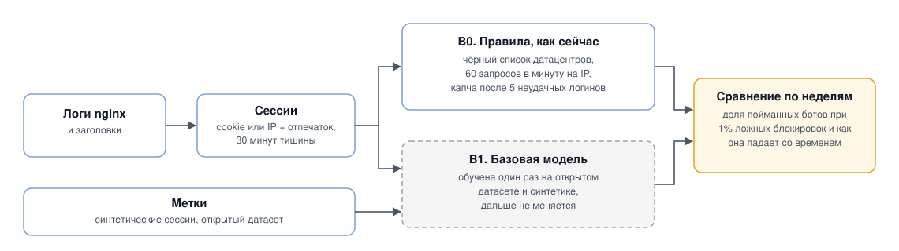
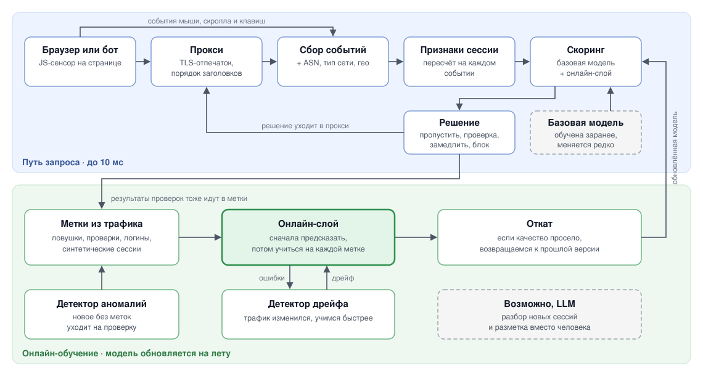

# ML System Design Doc: детектор ботов в веб-трафике

Bot Detector, MVP. Структура по [шаблону Reliable ML](https://github.com/IrinaGoloshchapova/ml_system_design_doc_ru/blob/main/ML_System_Design_Doc_Template.md).

## 1. Цели и предпосылки

### 1.1. Зачем идём в разработку продукта?

Боты дают больше половины трафика в интернете. По [отчёту Imperva за 2025 год](https://www.thalesgroup.com/en/news-centre/press-releases/artificial-intelligence-fuels-rise-hard-detect-bots-now-make-more-half), в 2024-м на них пришлось 51% трафика, причём вредоносные боты составили 37% всего трафика. Они скачивают каталог и цены, перебирают пароли, накручивают просмотры и регистрации, нагружают сервер. Для бизнеса это искажённая аналитика, угнанные аккаунты, простои сайта и лишние расходы на серверы.

Сейчас от ботов защищаются правилами, которые пишут вручную: чёрные списки IP, лимит запросов в минуту, капча. Правило появляется только после атаки: кто-то замечает аномалию, разбирает логи, пишет правило и выкатывает его. Это занимает дни, а чтобы обойти правило, боту хватает поменять одну деталь.

Обходить такие правила стало просто:

- резидентные прокси дают боту тысячи домашних IP, поэтому чёрные списки почти не работают, зато под них попадают обычные люди, которые сидят за одним общим IP (NAT);
- запросы можно раскидать по 10 тысячам адресов, и лимит в минуту не сработает ни на одном;
- капчу за копейки решают специальные сервисы и мультимодальные модели;
- AI-агенты работают через настоящий браузер и делают паузы как человек, поэтому правила про слишком быстрые запросы или про клиентов без JavaScript их не ловят.

Цель проекта: ловить больше ботов, реже блокировать живых людей и перестать переписывать правила вручную.

Модель для этого нужна, потому что она смотрит сразу на много сигналов: сеть, TLS-отпечаток, тайминги, путь по сайту, движения мыши. Один сигнал подделать легко, а десяток сразу так, чтобы они не противоречили друг другу, уже сложно и дорого.

Главная идея проекта: онлайн-обучение. Мы не переобучаем модель раз в день или раз в неделю. Базовую модель обучаем заранее на открытом датасете и на синтетических сессиях (1.4), она знает общие признаки ботов. Поверх неё работает онлайн-слой, который дообучается прямо на потоке, на каждой новой метке. Метка это ответ, бот перед нами или человек, который мы узнаём уже постфактум. Откуда они берутся без ручной разметки, описано в 1.4.

Трафик у каждого сайта свой и постоянно меняется: появляются новые боты, обновляются браузеры, на распродаже нагрузка вырастает в пять раз. Онлайн-слой подстраивается под это за минуты и не ждёт ночного переобучения.

Успехом итерации считаем, если:

- модель ловит не меньше 90% ботов при доле ложных блокировок не больше 1%, и это минимум на 20 процентных пунктов лучше текущих правил;
- новый вид бота, которого не было в обучении, начинает ловиться в течение часа после появления;
- после резкой смены трафика качество возвращается к норме за час, без ручного вмешательства;
- за время пилота никто не пишет ни одного нового правила вручную.

### 1.2. Бизнес-требования и ограничения

**Бизнес-требования**

| | Требование |
|---|---|
| БТ-1 | Для каждой сессии считаем вероятность того, что это бот, тип клиента (человек, полезный бот, AI-агент или другая автоматизация) и три главные причины решения |
| БТ-2 | Реакция зависит от уверенности модели: пропустить, показать невидимую проверку, замедлить или заблокировать. На логине пороги строже, чем на каталоге. Пороги меняются в конфиге |
| БТ-3 | Модель дообучается онлайн на каждой новой метке, без ручных правил и без переобучения по расписанию |
| БТ-4 | Если трафик резко поменялся, модель это замечает и начинает учиться быстрее |
| БТ-5 | AI-агенты выделены в отдельный класс. Агентов, которые подписывают свои запросы, обрабатываем по отдельной политике |
| БТ-6 | Поисковики, мониторинг и партнёрские интеграции не блокируются |
| БТ-7 | Если после обновления качество просело, модель сама возвращается к последней хорошей версии. Есть ручной выключатель, который отключает модуль целиком |

**Ограничения**

- Если модуль упал, сайт продолжает работать: трафик проходит без проверки, действуют старые правила.
- Модуль добавляет к запросу не больше 10 мс в 99% случаев. Для этого прокси перед сайтом берёт готовое решение из Redis, а модель считает отдельно и асинхронно.
- Заблокировать живого покупателя обычно хуже, чем пропустить бота на каталоге. На логине наоборот. Поэтому пороги свои для каждой страницы.
- Человек со скринридером или без мыши не должен попадать под блок только из-за того, что мышь не двигается. Ошибки на таких людях считаем отдельно.
- IP, отпечатки и поведение относятся к персональным данным (152-ФЗ, GDPR). IP храним в виде хэша, сырые IP не дольше 7 дней. Что человек вводит в поля, не собираем, только тайминги.
- Онлайн-обучение можно отравить: бот ведёт себя прилично, и модель учится считать его человеком. Поэтому разным источникам меток доверяем по-разному и ограничиваем вклад одного IP и одного отпечатка.
- Клиенту не показываем скор, иначе по нему можно подбирать обход.

От итерации ожидаем: синтетический трафик людей и ботов четырёх поколений, базовую модель, онлайн-слой с детектором дрейфа (он замечает, что трафик поменялся) и откатом, а также скоринг в shadow mode.

Встраиваем модуль постепенно:

1. Первые две недели shadow mode. Модель считает скор и учится, но ничего не блокирует, решения принимают старые правила.
2. Потом на 10% сессий включаем мягкие действия: невидимую проверку и замедление.
3. После этого включаем блокировки на логине и регистрации.

Правила всё это время остаются запасным вариантом. Если по ложным блокировкам модель не дотянет до цели, её скор станет ещё одним сигналом для правил.

### 1.3. Что входит в скоуп проекта/итерации, что не входит

В итерацию входят все требования из таблицы выше, но на синтетическом трафике: базовая модель, онлайн-слой, детектор дрейфа, автоматический откат, пороги в shadow mode и на 10% трафика, отдельный класс для AI-агентов и список разрешённых ботов.

Не входят:

- настоящие блокировки на чужом продакшене;
- мобильные приложения и API без JavaScript, для них будут только сетевые признаки;
- DDoS на уровне сети, это задача CDN;
- платёжный фрод и мультиаккаунты;
- своя капча и нейросети по последовательности событий;
- интерфейс для поддержки и апелляций, причины решений пока пишутся только в лог.

**Качество кода и воспроизводимость.** ruff, mypy, pre-commit и CI на каждый PR. Данные будем хранить в DVC, эксперименты вести в MLflow. Онлайн-обучение можно воспроизвести: записанный поток событий проигрывается заново в том же порядке, и метрики получаются те же. Сервис должен подниматься одной командой `docker compose up`.

**Техдолг, который оставляем на потом:** готовые алгоритмы вместо своих, ручное обновление базовой модели, нет отдельного хранилища признаков (feature store) и A/B-платформы, всё работает на одной VM.

### 1.4. Предпосылки решения

Оцениваем сессию, а не IP. Сессия это цепочка запросов одного клиента. IP для этого не подходит: у тысяч людей он общий, а у атакующего их сколько угодно. Сессию определяем по cookie, а если cookie нет, то по хэшу из подсети, TLS-отпечатка и User-Agent. Сессия заканчивается после 30 минут тишины.

Скор пересчитываем на каждом событии. На первом запросе у нас есть только сеть, TLS и заголовки, потом добавляются тайминги, переходы и движения мыши. Перебор паролей хочется поймать на третьем запросе, а не на трёхсотом.

Предварительно модель состоит из двух слоёв. Базовая обучается офлайн и почти не меняется. Онлайн-слой берёт её скор и свежие признаки и дообучается на потоке. Базовая модель не даёт онлайн-слою забыть общие признаки ботов из-за пары необычных дней, а онлайн-слой подстраивается под конкретный сайт и его текущий трафик.

**Данные.** Продакшен-трафика у меня нет, поэтому источника три:

1. Открытый [Web Bot Detection Dataset](https://bordar.bournemouth.ac.uk/272/) ([Iliou et al., 2021](https://doi.org/10.1145/3447815)) с логами и движениями мыши людей и ботов. На нём обучаем базовую модель.
2. Синтетические сессии людей и ботов четырёх поколений. Генерируем их с помощью LLM (Claude) в том же формате, что и датасет, поэтому метка известна заранее. Из них собираем потоки, где новый вид ботов появляется посередине, и смотрим, как быстро модель его подхватит. Подробности в этапе 3 раздела 2.3.
3. Логи реального сайта в shadow mode, если найдётся партнёр.

**Сигналы**

| Группа | Что смотрим |
|---|---|
| Сеть | ASN (сеть провайдера); датацентр, домашний провайдер, мобильная сеть или VPN; сколько сессий идёт с одного IP и подсети |
| TLS и заголовки | [JA4](https://github.com/FoxIO-LLC/ja4), отпечаток TLS-рукопожатия: по нему видно, браузер это или скрипт; порядок заголовков; совпадает ли User-Agent с TLS |
| Тайминги | интервалы между запросами, насколько они ровные, сколько прошло до первого действия |
| Навигация | путь по сайту, грузит ли клиент картинки и стили, ошибки 4xx, переходы по ловушкам |
| Поведение | траектория мыши, в какое место кнопки приходится клик, скролл, ритм нажатий без самих символов |
| Браузер | `navigator.webdriver`, признаки headless-режима (браузер без окна), совпадают ли экран, шрифты и часовой пояс |
| Бизнес-события | неудачные логины, регистрации, корзина без просмотра товара |
| Декларации | User-Agent краулеров и агентов, подпись запросов по [Web Bot Auth](https://datatracker.ietf.org/doc/draft-ietf-webbotauth-httpsig-protocol/) |

**Поколения ботов.** По ним синтезируем сессии и проверяем, ловит ли модель вид ботов, которого не было в обучении.

| Поколение | Чем себя выдаёт |
|---|---|
| Скрипты: requests, curl, Scrapy | TLS не как у браузера, нет JavaScript, не грузят картинки, ровные интервалы |
| Headless-браузеры: Playwright, Selenium | флаг webdriver, следы автоматизации, мышь не двигается |
| Stealth-браузеры, которые маскируют автоматизацию, с резидентными прокси | сигналы не сходятся между собой, слишком гладкая мышь, один отпечаток на тысячах сессий |
| AI-агенты, где браузером управляет LLM | перед каждым действием пауза в несколько секунд, пока думает модель; курсор прыгает и кликает ровно в центр кнопки; текст вставляется целиком |

Агентов, которые честно представляются и подписывают запросы, пропускаем по отдельной политике. Ловим тех, кто притворяется человеком.

**Метки.** Онлайн-слою нужны метки прямо в потоке. Собирать их можно без ручной разметки:

- синтетические сессии: метка известна заранее и точная;
- ловушки, то есть невидимые ссылки и скрытые поля форм: человек на них не нажмёт, значит это бот. Ловятся за минуты;
- невидимая проверка в браузере: ответ приходит за секунды;
- серия неудачных логинов по разным аккаунтам: почти наверняка перебор паролей;
- отложенные метки, например бан аккаунта через несколько дней. Онлайн-слой учится на них, когда они приходят, по сохранённым признакам сессии.

Метку человека ставим только когда уверены, например если у аккаунта есть история и покупки. Если бота не поймали, это не значит, что он человек, поэтому такие сессии меткой не считаем. Источникам доверяем по-разному, а вклад одного IP или отпечатка ограничиваем, чтобы ферма ботов не переучила модель под себя.

Отдельно про оценку ложных блокировок. Чтобы показать, что их меньше 0.1%, нужно минимум 3000 сессий живых людей без единой ошибки (правило трёх: при нуле ошибок на n примерах верхняя граница около 3/n). Сессий живых людей у нас 106, все из открытого датасета. Этого хватает, чтобы показать FPR ниже 3%. Синтетические сессии людей для такой оценки не годятся: их поведение задаёт генератор. Поэтому 1% на своих данных это ориентир для порогов, а подтвердить 1% и 0.1% можно только на данных партнёра.

## 2. Методология

> Решение предварительное. Конкретные модели и архитектуру выберем после EDA и первых экспериментов, и по ходу курса решение будет меняться.

### 2.1. Постановка задачи

Технически это бинарная классификация сессий на потоке: по признакам сессии модель оценивает вероятность того, что это бот, и пересчитывает её с каждым новым событием.

Модель учится онлайн. Когда для сессии приходит метка, модель сначала делает по ней предсказание, мы записываем, ошиблась она или нет, и только потом модель учится на этом примере. Поэтому качество видно непрерывно, а не раз в неделю на отложенной выборке.

Кроме классификации нужны ещё две вещи: замечать, что трафик поменялся (дрейф), и находить новые паттерны, для которых меток пока нет.

Возможно, часть решения будет на LLM: например, разбирать новые и сложные сессии и размечать их вместо человека или объяснять, почему сессию заблокировали. В пути запроса LLM вряд ли поместится из-за задержки и стоимости, поэтому она скорее будет работать рядом и асинхронно. Окончательно решим по результатам экспериментов.

Основная метрика: какую долю ботов ловим при доле ложных блокировок не больше 1%. Дополнительно смотрим, как быстро модель восстанавливается после смены трафика и не копятся ли ложные блокировки на отдельных группах людей, например у пользователей скринридеров.

### 2.2. Блок-схема решения

Обе схемы предварительные и будут уточняться.

**Бейзлайн.** Текущие правила и базовая модель, обученная один раз. Ожидаю, что модель начнёт ошибаться, когда появятся новые боты. Это и есть аргумент за онлайн-обучение.

**MVP.** Сверху путь запроса, снизу онлайн-обучение на метках из трафика.

### 2.3. Этапы решения задачи

Этапы 1 и 2 общие для любой ML-задачи, этапы 3–5 специфичны для нашей.

#### Этап 1. Подготовка данных

**Данные и сущности.** Основной источник сейчас: открытый [Web Bot Detection Dataset](https://m4d.iti.gr/web-bot-detection-dataset/). Это логи сайта с копией страниц Википедии и движения мыши его посетителей: людей, moderate-ботов (у них отпечаток настоящего браузера) и advanced-ботов (они ещё и имитируют поведение человека). Все цифры ниже взяты из [отчёта EDA](../reports/eda.md).

| Сущность | Что это | Сколько в датасете |
|---|---|---|
| Запрос | строка лога Apache: время, путь, код ответа, referrer, PHP session ID, User-Agent | 305 785, из них 140 364 в размеченных сессиях |
| Сессия | запросы с одним session ID без пауз дольше 30 минут | 290 размеченных |
| Событие мыши | движение или клик: время в миллисекундах и координаты | 2.3 млн движений |
| Метка | человек, moderate-бот или advanced-бот | 106, 78 и 106 сессий |

**Как появляются данные**

| Источник | Формат | Регулярность |
|---|---|---|
| Открытый датасет | zip на 32 МБ: логи Apache, движения мыши в JSON, метки в текстовых файлах. Скачивается командой `make data` | разовая выгрузка: фаза 1 собрана осенью 2019 года, фаза 2 в 2020-м |
| Синтетические сессии (этап 3) | тот же формат: запросы, события мыши, метка | генерируем партиями под каждый эксперимент |
| Реальный сайт, если найдётся партнёр | прокси пишет запросы, скрипт на странице отправляет события мыши | непрерывный поток |

**Проблемы и риски, которые показал EDA**

- **Данных мало.** 290 сессий и 4 351 просмотр страницы. 94% запросов в размеченных сессиях это служебная отправка движений мыши.
- **Классы различаются не только поведением.** Людей и ботов собирали в разные дни. В фазе 2 все боты пришли с одного браузера на Linux, с локального адреса и с двумя размерами окна, а у людей 19 браузеров и 30 размеров окна. Такие признаки (User-Agent, адрес, размер окна, время сбора) в модель не берём.
- **Протокол сбора виден в признаках.** В фазе 2 людей просили провести на сайте 15–20 минут, а боты останавливались не позже 20-й страницы. Поэтому длительность сессии разделяет классы почти полностью, но это свойство эксперимента, а не ботов.
- **Боты слишком простые.** Они двигают мышь почти с постоянной скоростью: у всех moderate-ботов медиана 62.5 px/с, у всех advanced-ботов 500 px/с. Один признак, разброс интервалов между событиями мыши, полностью отделяет ботов от людей в обеих фазах. Качество на этом датасете будет завышенным, и модель может выучить особенности одного генератора ботов.
- **Не все признаки переносятся между фазами.** Прямолинейность движений у moderate-ботов в фазе 1 такая же, как у людей (0.93), а в фазе 2 она 0.35 против 0.95 у людей.
- **Разметка неполная.** 52% строк лога относятся к 566 сессиям без метки. Ещё 2.4% идут без session ID: это сканеры из интернета.
- **Части сигналов из 1.4 в датасете нет.** Нет IP, TLS и заголовков, кроме User-Agent и referrer. Все ответы сервера 200. На сайте нет логина и форм. Нет скриптов без браузера, AI-агентов и смены трафика во времени.

Мелкие дефекты формата (обрезанное время кликов, события не по порядку, разные переводы строк в файлах меток) перечислены в отчёте, парсер их исправляет.

**Если данных не хватает**

| Что нужно измерить | Сколько данных нужно | Где берём |
|---|---|---|
| Recall 90% ± 5 п.п. по каждому поколению ботов | около 150 сессий на поколение (1.96² · 0.9 · 0.1 / 0.05²) | синтез, этап 3 |
| Скорость реакции на новое поколение ботов и на смену трафика | несколько потоков по несколько часов | синтез, этап 3 |
| FPR на живых людях | для 1% нужно от 300 сессий людей, для 0.1% от 3000 (правило трёх из 1.4). В датасете их 106, этого хватает только на FPR ниже 3% | только партнёр |

Недостающие сессии синтезируем с помощью LLM (этап 3). Живых людей синтез не заменяет, поэтому FPR на своих данных остаётся грубой оценкой.

**Конфиденциальные данные.** В датасете нет IP (авторы заменили их прочерком), аккаунтов и введённого текста. Остаются User-Agent и траектории мыши. Траектория мыши это поведенческая биометрия, поэтому сырые данные в git не кладём и дальше не распространяем. Синтетические сессии персональных данных не содержат. На реальном сайте действуют правила из 1.2: IP сразу хэшируем, сырой IP храним не дольше 7 дней, из полей ввода берём только тайминги.

**Результат этапа.** Загрузка датасета одной командой, парсер логов и движений мыши, таблица сессий с признаками и метками под DVC, зафиксированное разбиение и отчёт EDA.

#### Этап 2. Подготовка прогнозных моделей

**Метрики**

| Метрика | Почему она |
|---|---|
| Recall при FPR ≤ 1%, основная | повторяет цель из 1.1: поймать не меньше 90% ботов и почти не трогать людей |
| PR-AUC | показывает качество на всех порогах и устойчива к дисбалансу классов |
| Brier score и график калибровки | пороги из БТ-2 задаются по вероятности, поэтому она должна быть честной |
| Recall по каждому типу ботов | общий recall скрывает тип, который модель пропускает |
| После какой страницы сессия получает верное решение | бота нужно поймать в начале сессии, а не в конце |

Для онлайн-слоя добавляются recall и FPR в скользящем окне и время, за которое модель начинает ловить новый тип ботов.

**Функция потерь.** Log loss (бинарная кросс-энтропия). Она даёт калиброванные вероятности. Recall при фиксированном FPR напрямую оптимизировать нельзя, поэтому порог подбираем отдельно на валидации. Примеры взвешиваем по классу и по доверию к источнику метки (этап 4).

**Схема валидации**

- **По фазам.** Учимся на фазе 1 (2019 год), проверяем на фазе 2 (2020 год, сайт почти вдвое больше, другие люди). Это разбиение по времени, и оно ловит признаки, которые не переносятся.
- **Без одного типа ботов.** Обучаем без одного типа (moderate, advanced или одно синтетическое поколение) и проверяем на нём. Так меряем главное требование: ловить бота, которого не было в обучении.
- **Визиты одного посетителя вместе.** Все визиты с одним session ID попадают в одну часть выборки.
- **Онлайн-слой.** Проигрываем поток в исходном порядке. На каждой метке модель сначала предсказывает, потом учится (prequential-оценка).
- **Интервалы.** Данных мало, поэтому к каждой метрике считаем доверительный интервал бутстрепом по сессиям.
- **Скорость.** Отдельно меряем время расчёта скора. Модель работает асинхронно (1.2), но должна успевать за потоком событий.

**Бейзлайн.** Сравниваем три варианта на одном тесте:

1. Правила: лимит запросов в минуту и чёрный список User-Agent.
2. Порог по одному признаку из EDA, разбросу интервалов между событиями мыши. Порог, подобранный на фазе 1, ловит всех ботов фазы 2 при FPR 7%. Модель обязана быть лучше.
3. Логистическая регрессия, затем градиентный бустинг на признаках сессии.

Предобработка для третьего варианта: склеиваем запросы в сессии, отделяем просмотры страниц от служебных запросов, считаем признаки по логам (число страниц, паузы между ними и их разброс) и по мыши (разброс скорости, разброс интервалов между событиями, прямолинейность, паузы). Счётчики логарифмируем, для регрессии признаки стандартизуем. Признаки-утечки и длительность сессии не берём. Скор считаем и по началу сессии: после 1, 3, 5 и 10 страниц.

**Дальнейшее развитие.** Признаки, которых нет в датасете (TLS-отпечаток, заголовки, согласованность сигналов между собой), проверяем на синтетических сессиях. Гиперпараметры подбираем через Optuna на валидации по фазам, вероятности калибруем изотонической регрессией. Поверх базовой модели ставим онлайн-слой (этап 5). Эксперименты ведём в MLflow.

**Анализ и интерпретация.** Для базовой модели считаем SHAP. Если самым важным оказался признак, который описывает сбор данных, а не поведение, это утечка. Три главные причины решения по каждой сессии (БТ-1) тоже берём из SHAP. Ошибки разбираем по типам ботов и отдельно по коротким сессиям.

**Риски**

| Риск | Как снижаем |
|---|---|
| Модель учит особенности сбора данных или генератора ботов | убираем признаки-утечки, проверяем по фазам и без одного типа ботов |
| Данных мало, модель переобучается | простые модели, регуляризация, доверительные интервалы |
| Качество на датасете завышено, потому что боты простые | сложных ботов добавляем синтезом, итог считаем по худшему типу ботов |
| Модель считает ботом человека без мыши | отсутствие мыши кодируем отдельным флагом, FPR на таких сессиях считаем отдельно |
| FPR 1% не подтвердить на 106 сессиях людей | показываем доверительный интервал, подтверждаем только на данных партнёра |

**Результат этапа.** Три бейзлайна с метриками в MLflow, базовая модель с калибровкой и порогами, отчёт с разбором ошибок.

#### Этап 3. Синтез данных

Синтезом закрываем то, чего нет в датасете: скрипты без браузера, stealth-браузеры, AI-агентов, сетевые признаки и смену трафика во времени.

- **Что генерируем.** Сессии в том же формате, что и разобранный датасет: запросы с временем и путём, события мыши, метка и поколение бота.
- **Как.** LLM (Claude) получает карту сайта, профиль клиента (класс, поколение, темп, устройство, есть ли мышь) и несколько реальных сессий из датасета как образец. Она возвращает сценарий сессии: какие страницы открыть, в каком порядке, с какими паузами и куда вести мышь. Код генератора разворачивает сценарий в события по параметрам профиля.
- **Потоки.** Из сессий собираем потоки на несколько часов, где новое поколение ботов появляется посередине, а нагрузка резко растёт.
- **Проверка качества.** Сравниваем распределения признаков синтетических и реальных сессий. Обучаем классификатор «синтетическая сессия или реальная»: если он легко их различает, генератор дорабатываем.
- **Воспроизводимость.** Промпты, профили и сиды храним в репозитории, готовые партии данных под DVC.

Главный риск: модель выучит следы генератора, а не поведение ботов. На открытом датасете это уже видно по постоянной скорости мыши. Поэтому делаем несколько разных профилей на поколение, качество меряем на поколении, которого не было в обучении, а FPR считаем только на реальных людях.

Результат: набор синтетических сессий (не меньше 150 на поколение), потоки для онлайн-экспериментов и отчёт о качестве синтетики.

#### Этап 4. Метки для онлайн-обучения

Онлайн-слою нужны метки прямо в потоке. Источники из 1.4 различаются точностью и скоростью:

| Источник | Что значит | Когда приходит | Где ошибается |
|---|---|---|---|
| Ловушки | бот | через минуты | скрытое поле заполнил менеджер паролей |
| Невидимая проверка | бот или человек | через секунды | боты обходят её через сервисы-решалки |
| Серия неудачных логинов | бот | через минуты | человек забыл пароль |
| Бан или история аккаунта | бот или человек | через дни | ошибки модерации, заранее «прогретые» аккаунты |

- У каждого источника свой вес доверия, он идёт в функцию потерь.
- Противоречивые метки по одной сессии в обучение не берём.
- С одного IP и одного отпечатка принимаем ограниченное число меток в час, чтобы ферма ботов не переучила модель под себя.
- В синтетическом потоке источники моделируем: метка приходит с задержкой и шумом своего источника.

Результат: модуль меток с весами, фильтрами и лимитами.

#### Этап 5. Онлайн-слой, дрейф и откат

- **Онлайн-слой** (библиотека River) получает скор базовой модели и свежие признаки и дообучается на каждой метке. Он выдаёт ограниченную поправку к скору базовой модели, поэтому не может её «забыть» и не может сильно занизить скор бота.
- **Дрейф.** Детектор ADWIN следит за ошибкой модели. При дрейфе онлайн-слой учится быстрее.
- **Откат.** Онлайн-слой постоянно сравниваем с базовой моделью на потоке. Если он хуже, возвращаемся к последней хорошей версии (БТ-7).
- **Проверка пользы.** На синтетических потоках сравниваем три варианта: базовая модель без изменений, переобучение раз в сутки и онлайн-слой. Смотрим recall при FPR ≤ 1% по часам и время до поимки нового поколения ботов. Если онлайн-слой не выигрывает, оставляем переобучение по расписанию.
- **Shadow mode.** Скоринг и обучение идут асинхронно, в пути запроса остаётся только чтение готового решения из Redis (1.2). Решения модели пишем в лог и сравниваем с правилами.

Результат: онлайн-слой с детектором дрейфа и откатом, сравнение трёх вариантов и сервис в shadow mode.
