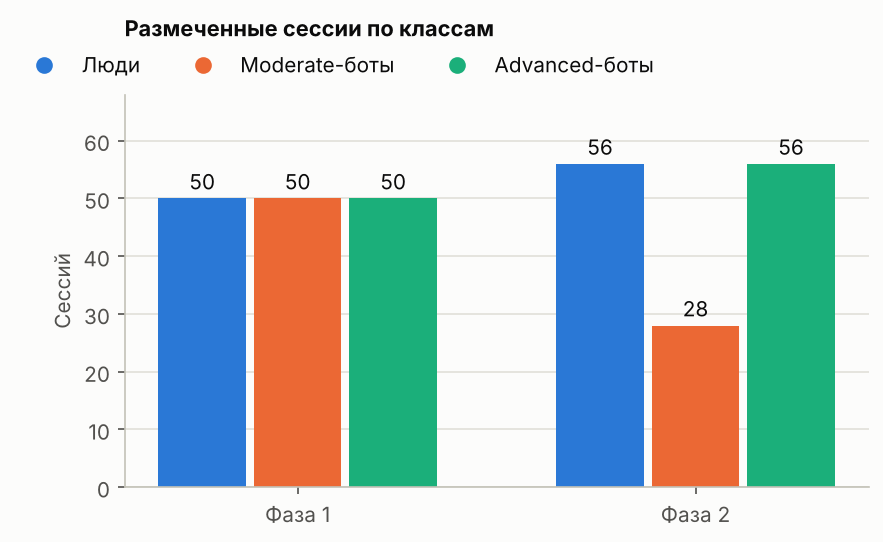
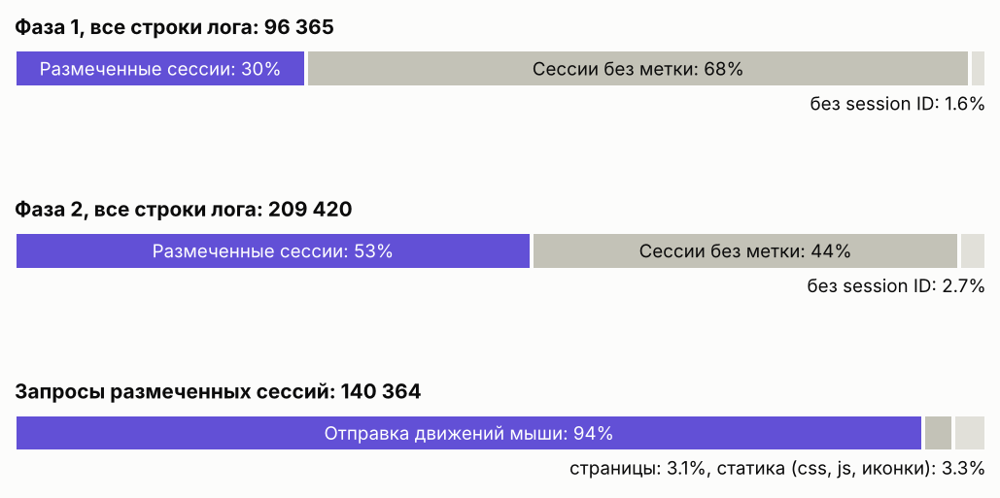
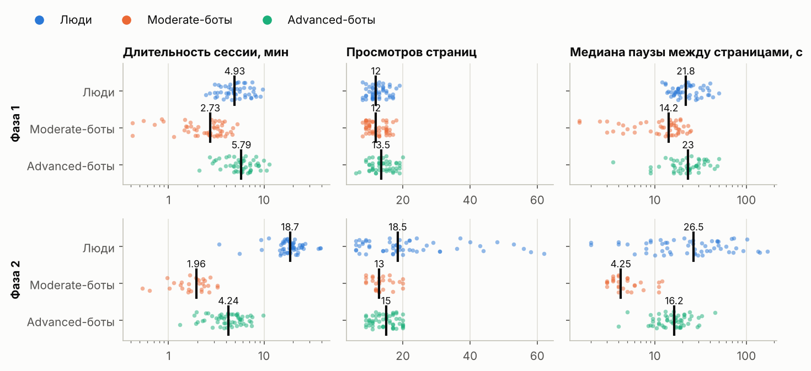
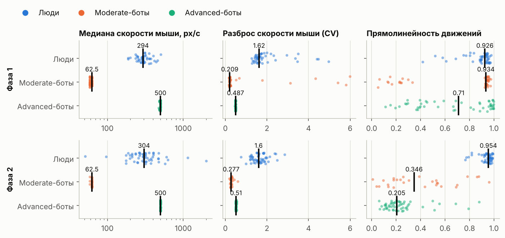
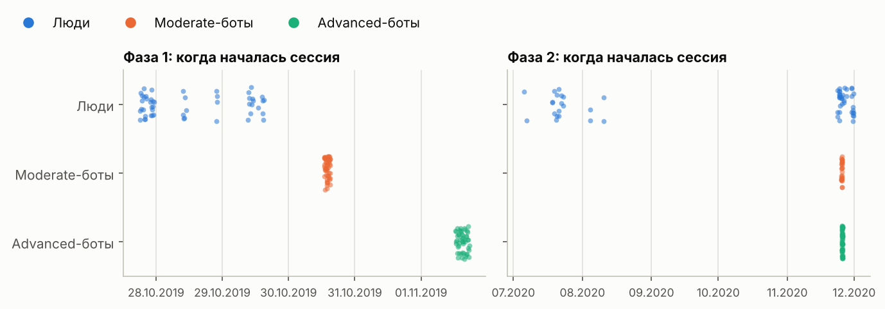
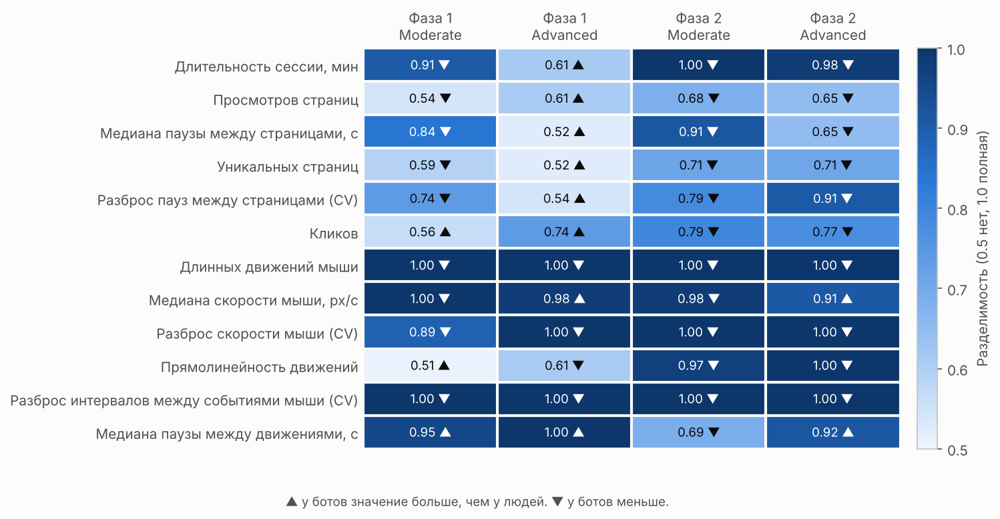

# EDA: Web Bot Detection Dataset

Разведочный анализ открытого датасета, на котором будем обучать базовую модель детектора ботов. Код лежит в [`notebooks/01_eda.ipynb`](../notebooks/01_eda.ipynb), выводы из отчёта перенесены в [дизайн-документ](../docs/ml_system_design_doc.md), раздел 2.3.

Как повторить:

```bash
make install
make data   # скачивает датасет в data/raw, в git он не попадает
make eda    # выполняет ноутбук и перерисовывает графики в reports/figures
```

## Данные

[Web Bot Detection Dataset](https://m4d.iti.gr/web-bot-detection-dataset/) ([Iliou et al., 2021](https://doi.org/10.1145/3447815)): zip на 32 МБ, 352 МБ после распаковки. Авторы подняли сайт с копией страниц Википедии и записали логи сервера и движения мыши посетителей трёх классов:

- люди;
- moderate-боты: у них отпечаток настоящего браузера;
- advanced-боты: отпечаток настоящего браузера и поведение, похожее на человеческое.

Датасет состоит из двух фаз.

| | Фаза 1 | Фаза 2 |
|---|---|---|
| Когда собрана | октябрь и ноябрь 2019 | июль–ноябрь 2020 |
| Страниц на сайте | 61 | 110 |
| Кто люди | авторы статьи | 28 приглашённых участников, каждого просили провести на сайте 15–20 минут |
| Логи | формат Apache, вместо IP прочерк, добавлен PHP session ID | то же |
| Движения мыши | отдельный JSON на сессию | выгрузка из MongoDB, одна запись на session ID |
| Метки | текстовые файлы с готовым разбиением на train и test | текстовые файлы без разбиения |

## 1. Объём и состав



Размеченных сессий 290: 106 людей, 78 moderate-ботов и 106 advanced-ботов. Классы сбалансированы, потому что авторы сами создавали столько же сессий ботов, сколько набралось сессий людей.



Всего в логах 305 785 строк и 2.3 млн событий движения мыши в размеченных сессиях.

**Выводы**

- Данных мало. 290 сессий хватит на базовую модель и проверку признаков, но не хватит на честную оценку ложных блокировок: 106 сессий людей без единой ошибки дают только верхнюю границу FPR около 3%.
- Больше половины логов использовать нельзя: 52% строк относятся к 566 сессиям, для которых нет меток.
- 94% запросов в размеченных сессиях это служебная отправка движений мыши. Просмотров страниц всего 4 351, в среднем 15 на сессию. Тайминги нужно считать только по страницам, иначе признаки будут описывать трекер мыши, а не посетителя.

## 2. Качество

| Проверка | Результат |
|---|---|
| Строки лога, которые не разбираются | 11 из 305 796. Это попытки SQL-инъекций с кавычками внутри запроса |
| Размеченные сессии без логов или без данных мыши | 0 из 290 |
| Сессии с противоречивой меткой | 0 |
| Запросы без session ID | 7 313 (2.4%). Это шум из интернета: сканеры уязвимостей, `CONNECT`, запросы без User-Agent |
| Коды ответа в размеченных сессиях | 140 360 раз 200 и 4 раза 304. Ошибок 4xx нет |
| Полные дубли строк в размеченных сессиях | 27 929, из них 27 880 это отправка движений мыши. Время в логе записано с точностью до секунды, поэтому это не ошибка |
| Session ID в метках фазы 2 | с суффиксом `_0`, `_1`, `_2`: один session ID покрывает несколько визитов. Правило в README не описано. Разбиение по паузе в 30 минут находит все 140 размеченных сессий |
| Время кликов в данных мыши фазы 2 | обрезано до девяти цифр у 3 538 кликов. Старшие разряды восстанавливаем по соседним событиям |
| Порядок событий мыши | в 20 сессиях события идут не по времени, сортируем |
| Файлы меток | в четырёх файлах переводы строк CRLF, в двух LF |

**Выводы**

- Размеченная часть чистая: пропусков нет, все дефекты это особенности формата, и парсер их исправляет.
- В логах нет IP и кодов ошибок, а на сайте нет логина и форм. Сетевые признаки, долю ошибок и бизнес-события на этих данных проверить нельзя.
- В «человеческих» логах есть настоящие боты из интернета (сканеры), но без меток и без session ID. В обучение они не попадают.

## 3. Сессии по логам

Точка это сессия, чёрная черта это медиана класса.



**Выводы**

- Moderate-боты торопятся: медиана паузы между страницами у них 14.2 секунды в фазе 1 и 4.2 секунды в фазе 2, у людей 21.8 и 26.5 секунды.
- Advanced-ботов по логам от людей почти не отличить. В фазе 1 ни один признак из логов не разделяет их лучше, чем на 0.61 (ROC AUC, где 0.5 это случайное угадывание).
- В фазе 2 длительность сессии разделяет классы почти полностью, но это след протокола сбора. Людей просили провести на сайте 15–20 минут, и 88% их сессий длиннее 15 минут. Ни одна сессия бота не длиннее 20 страниц и 11.3 минуты. Длительность в модель брать нельзя.

## 4. Движения мыши



Скорость считаем между соседними событиями одного движения. Разброс это коэффициент вариации (CV): стандартное отклонение, делённое на среднее. Прямолинейность это отношение расстояния между началом и концом движения к длине пройденного пути.

**Выводы**

- Боты двигают мышь почти с постоянной скоростью. У всех moderate-ботов медиана 62.5 px/с, у всех advanced-ботов 500 px/с, и так в обеих фазах. У людей медиана около 300 px/с, а разброс скорости внутри сессии в 3–8 раз больше, чем у ботов.
- Мышь разделяет классы гораздо лучше логов. Именно по ней ловятся advanced-боты.
- Поведение ботов между фазами изменилось. В фазе 1 moderate-боты двигались так же прямо, как люди (0.93), в фазе 2 их траектории стали извилистыми (0.35 против 0.95 у людей). Признак, полезный в одной фазе, в другой может не работать.

## 5. Утечки

Классы различаются не только поведением.



| | Фаза 1 | Фаза 2 |
|---|---|---|
| Дни сбора | люди 27–29 октября, moderate-боты 30 октября, advanced-боты 1 ноября | люди с июля по ноябрь (17 дней), все боты 25 ноября |
| User-Agent | у людей один браузер, у всех ботов другой | у людей 19 разных, 54 сессии из 56 на Windows. У всех ботов один, на Linux |
| Адрес сайта | у всех одинаковый | люди ходили на публичный адрес, боты на локальный `192.168.1.120` |
| Размер окна браузера | не записан | у людей 30 разных, у ботов два |

**Выводы**

- В фазе 1 людей и ботов полностью разделяют день сбора и User-Agent. В фазе 2 их полностью разделяют User-Agent, адрес сайта и размер окна, а день сбора почти полностью: на день ботов пришлось только 5 сессий людей.
- Эти признаки описывают, как собирали данные, а не как ведут себя боты. В модель их не берём.
- Случайное разбиение на train и test такую утечку не покажет. Нужна проверка на другой фазе.

## 6. Насколько классы разделяет один признак

Для каждого признака считаем ROC AUC «бот против человека» и показываем расстояние до 0.5: 0.5 значит, что признак ничего не даёт, 1.0 значит, что он разделяет классы полностью.



Порог, подобранный на фазе 1, проверяем на фазе 2:

| Признак | Точность на фазе 1 | Точность на фазе 2 | Recall ботов на фазе 2 | FPR на фазе 2 |
|---|---|---|---|---|
| Разброс интервалов между событиями мыши | 1.00 | 0.97 | 1.00 | 0.07 |
| Разброс скорости мыши | 0.96 | 0.99 | 1.00 | 0.02 |
| Длинных движений мыши | 0.99 | 0.91 | 1.00 | 0.21 |
| Медиана паузы между движениями | 0.94 | 0.70 | 0.73 | 0.34 |
| Медиана паузы между страницами | 0.68 | 0.76 | 0.98 | 0.57 |

**Выводы**

- Боты в датасете слишком простые. Один признак, разброс интервалов между событиями мыши, полностью разделяет ботов и людей в обеих фазах. Порог по нему, выбранный на фазе 1, ловит всех ботов фазы 2 при 7% ложных срабатываний.
- Высокое качество модели на этом датасете ничего не скажет о качестве на настоящем трафике. Модель может выучить особенности одного генератора ботов, например постоянную скорость мыши.
- Порог по одному признаку становится обязательным бейзлайном: модель должна быть лучше него.

## Итог

Что берём из датасета:

- базовую модель и проверку признаков по логам и мыши;
- парсер и формат сессий, в котором будут и синтетические данные;
- бейзлайн: порог по одному признаку мыши.

Риски и что с ними делаем:

| Риск | Решение |
|---|---|
| Данных мало: 290 сессий, из них 106 людей | недостающие сессии ботов синтезируем (этап 3 дизайн-документа). Ко всем метрикам считаем доверительные интервалы |
| Утечки через дату, User-Agent, адрес и размер окна | не берём эти признаки, проверяем модель на другой фазе |
| Длительность сессии отражает протокол сбора | не берём длительность, считаем скор по первым страницам сессии |
| Боты слишком простые, качество будет завышено | добавляем синтетические поколения ботов, проверяем на типе ботов, которого не было в обучении |
| Признаки не переносятся между фазами | учимся на фазе 1, проверяем на фазе 2 |
| Нет IP, TLS, ошибок, логина, AI-агентов и смены трафика во времени | проверяем это на синтетических сессиях и потоках |
